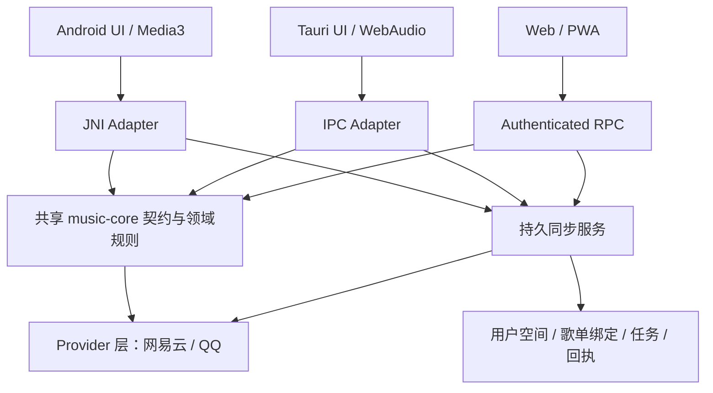

# Claudio 多音源与跨端歌单同步开发计划

日期：2026-09-14。范围：网易云、QQ 音乐，以及现有 Android、Tauri 桌面、Web/PWA 客户端。

> 当前执行范围（2026-09-14 用户确认）：仅改造 Android 应用及必要的 Android Rust/JNI 桥接。下文跨端方案保留为原计划参考；本轮不修改桌面、PWA、服务端或部署。Android 使用平台无关接口和应用内持久同步任务，跨设备服务不在本轮交付范围。Android 专项唯一执行队列为 `android-native/multi-provider-manifest.json`。功能实现已授权；真实账号验收需在应用内登录并使用指定的同步歌单，不在聊天中交换凭据。

本计划的目标是：用户管理一份资料库和歌单，混合收听两家平台的歌曲，在平台允许收藏且匹配到同一录音版本时，自动补齐已关联歌单中的缺项。推荐继续使用统一的口味和反馈，增加音源不意味着每次等待两家完整返回。

计划已进入 Android 实施。当前源码、构建与未验证项见第 9 节；下文的运行完成条件仍是验收要求，不是已通过的结果。

## 1. 先明确交付范围

| 范围 | 本次目标 | 完成边界 |
| --- | --- | --- |
| 音源 | 网易云、QQ；使用可注册的 Provider 接口 | 两家分别通过登录、搜索、播放、收藏和歌单操作验证；后续音源按实际能力扩展 |
| Android 原生 | 保留 Kotlin/Compose、Media3 和 Rust/JNI 架构 | 混播、推荐、资料库、同步及原有后台播放链路都要回归 |
| Tauri 桌面 | 保留 React/Next 与 Rust IPC | macOS、Windows、Linux 分别记录构建与运行结果；一个系统通过不能代表另外两个 |
| Web/PWA | 保留 Next 服务端、浏览器客户端与现有 Rust bridge | 桌面浏览器、Android Chrome、iPhone/iPad Safari 及主屏幕 PWA 分别验收 |
| 原生 iOS | 当前没有原生工程 | 本次 iPhone/iPad 交付按 PWA；原生 iOS 需要另行立项 |
| 多设备 | 同一 Claudio 用户空间共享歌单映射、同步结果、资料库身份和口味反馈 | 浏览器本地缓存、Cookie 会话和音频缓存不充当跨设备数据库 |

“所有功能正常使用”指本计划覆盖的功能及其受影响的既有链路。平台缺少歌曲、账号失效或接口拒绝时，必须给出准确状态和恢复入口；不能用空列表、假成功或无限加载掩盖失败。

## 2. 源码现状决定开发顺序

基线是当前 `main` 工作区，HEAD 为 `5dfd65569b711ffd9462e0e6e3f9c69bd5b9896e`，同时包含尚未提交的 Android、Rust、PWA 和部署变更。后续实现应按稳定批次读取当时差异，保留这些工作；本计划不以 HEAD 代替当前工作区内容。

外部参考为 Folia 的 `52081f79a8fce54286d57c7c7c47b568b135a069`。已确认的外部事实是适配器和依赖声明，不是当前真实账号可用性。

| 源码事实 | 对计划的影响 | 来源 |
| --- | --- | --- |
| Android `NativeTrack` 有字符串 `id`，但歌曲地址、收藏、歌单、续播和恢复大量依赖 `neteaseId: Long` | 先统一身份，再接 QQ；不能把 QQ mid 塞进网易云数字字段 | S01、S02 |
| Rust `TrackInfo`、歌单及 SQLite 曲目、歌词、音频缓存以 `i64` / `INTEGER` 为主键 | 数据、歌词、音频、分析特征和旧队列都要有迁移方案 | S03、S04 |
| Android JNI 直接引用桌面 Rust 的网易云实现；PWA bridge 又复用原生 bridge | 适合提取共享领域模块，避免三个客户端各写一套平台协议 | S05 |
| 网易云已有收藏、建歌单、歌单加删；某些返回码当前直接当成功处理 | 同步服务仍需读回核验，不能直接把现有布尔值当最终同步回执 | S06 |
| Android 推荐已有缓存、并行和 `hasEnough`；平台批次仍在判断足量之前 `awaitAll()` | 改为随结果到达合并、满足质量条件就结束等待 | S07 |
| Android/PWA 有歌名与艺人去重；PWA 的推荐 key 会去掉 Live、Remix 等版本信息 | 推荐候选去重不能直接充当“同一录音”的身份真相 | S08 |
| PWA 有真实网易云 RPC 路径，但每个浏览器会话使用独立 Rust 进程和数据目录 | 需要账号级持久同步状态；进程退出、换浏览器不能丢失歌单绑定 | S09 |
| PWA 资料库、队列主要在 IndexedDB/localStorage；另有独立 demo/probe | demo 只证明对应本地流程，不能证明真实音源和账号同步 | S10 |
| 桌面 CDN 白名单、Referer 和音频 scheme 当前专门服务网易云 | QQ 必须有独立媒体策略，覆盖 Range、重定向、鉴权和缓存 | S11 |
| Folia 注册三家音源，但 QQ `mutations: false`、`recommendations: false` | QQ 写入是首要外部能力门禁；不能宣称已取得 QQ 官方个性化推荐或写入能力 | S12 |

现有 `docs/development/execution-manifest.json` 属于 Android 旧改版，`docs/pwa/execution-manifest.json` 属于 PWA 专项。本计划不改写这两个队列，也不另建执行 Manifest。进入实际开发时，以本文件作为本次需求与依赖来源，再确定一份负责本次范围的执行队列。

## 3. 锁定用户可见行为

### 3.1 一份资料库，保留多个来源

- 同一录音版本在“全部歌曲”里显示一次，带网易云、QQ 来源标签。平台筛选只显示该平台的来源。
- 现场、翻唱、伴奏、重录、Remix、不同剪辑长度及不能确认的母带版本独立保存。不同音质作为来源下的音频选项。
- 同一录音收录在不同专辑时，歌曲总览可以合并，专辑页保留发行版本、曲序和归属。
- 高置信度匹配才自动关联。疑似重复可人工合并、拆开；拆开后记住否定关系，避免下次重新误合并。
- 播放优先使用用户指定来源，其次是满足权限和音质偏好的可用来源。备用来源仅限已确认的同一录音，切换要可见。
- “可收藏”和“可完整播放”独立判断。可以收藏的 VIP 歌曲不应因暂时无法完整播放而被排除出同步。

### 3.2 一份歌单，关联远端歌单

- 两家“我喜欢”按账号绑定为统一收藏。普通歌单使用固定绑定，不依赖名称作为 ID。
- 同名且内容一致可建议关联；部分重合或名称不同由用户选择关联一次。单纯同名不触发账号写入。
- 用户可以创建 Claudio 歌单，再选择关联已有远端歌单或创建对应的远端歌单；创建超时先查回执和远端结果，不盲目重建。
- 平台自己的收藏使用对应收藏操作；普通歌单使用加歌操作，二者不互相冒充。
- 只写入当前账号可编辑的歌单。收藏他人的歌单保持只读，也可选择复制到自己的同步歌单。
- 已有排序保留，新同步歌曲按稳定顺序追加。远端调序若无可靠接口，仅在 Claudio 内排序，并明确远端能力。

### 3.3 双向补齐收藏，删除单独控制

用户开启指定绑定的同步后，两端完整快照的并集形成首次目标。网易云有、QQ 没有的歌曲，匹配 QQ 对应录音并补齐；反向相同。在 Claudio 添加时向所有已开启且有写权限的绑定提交。

后续使用增量与上次完整快照判断新增，不能每次机械取并集。默认只自动传播新增，不自动传播取消收藏、删除整张歌单、重命名和覆盖远端排序。

为避免“刚取消又被加回来”，保存每个平台的明确移除记录：

- 用户在 Claudio 明确执行取消时，按界面选定的平台范围提交，并记录撤销版本。
- 完整远端快照确认外部移除后，记录该平台的补齐抑制，不自动加回；另一来源仍存在时保留统一曲目并显示部分同步。
- 用户再次明确添加时产生新版本，解除对应抑制。
- 失败、超时、账号失效和只读到部分分页，都不能被解释为删除。
- 跨平台删除等操作只有在该绑定单独启用对应策略后才传播；并发冲突不能靠设备时钟直接判定谁覆盖谁。

同步项显示“待同步、同步中、已同步、部分同步、版本待确认、目标平台无对应曲目、需要登录、失败待重试”。单首失败不停止整张歌单；找不到的版本不拿翻唱、现场或试听音频替代。

### 3.4 推荐和 AI 使用统一身份

- 一套口味、播放反馈和排除记录参与排序；同一录音从另一平台出现，不当成新发现重复推荐。
- 缓存和已有候选先参与计算；平台候选按需并行补充，达到数量、相关性、多样性和新歌手目标后结束本批等待。
- QQ 若无平台个性化推荐接口，使用统一口味生成的检索候选，不伪装成 QQ 官方日推。
- 不因多一个音源重复执行同一轮 AI。候选映射和目录核实结果缓存；音频 URL 在选中及即将播放时再解析。
- 慢平台结果可补下一批，不能重排正在播放的队列；不能让快平台长期排挤另一个来源的发现机会。
- AI 搜歌、点歌、加队列、收藏、歌单编辑、连续推荐和“不要这首”走同一 Provider 与身份边界。AI 回复根据真实回执说明成功数量与失败来源。

## 4. 共享领域规则，客户端保留各自播放能力

拟新增共享 Rust crate `crates/music-core/`，由 Tauri、Android JNI 和服务端 bridge 使用。模型、录音匹配、Provider 能力、推荐中与平台无关的规则、同步差异与回执放在这里；TS/Kotlin 通过同一版本的 DTO 与桥接接口消费。播放器、音频焦点、浏览器媒体会话和平台安全存储仍由各端负责。

### 4.1 Provider 是唯一平台接口边界

按功能声明能力：登录、搜索、详情、音频、歌词、用户歌单、收藏读取/写入、建歌单、增删曲、推荐，以及可选的改名、调序、删除。界面和 AI 根据实际能力工作；“未支持、无权限、未登录、需要验证、限流、网络失败、部分结果”必须区分。

保留现有 Rust 网易云协议实现。QQ 首轮采用已核实的 API 库作为受控服务端适配器候选，默认不在 Android、Tauri 中嵌入 Node 运行时；QQ 未提供的写入能力在 P0 内定位与验证，接口名称、参数和成功条件均以真实源码/响应为准。

桌面 IPC、Android JNI、PWA RPC 只做平台适配，不各自实现一套歌单同步算法。后续新音源实现同一契约，并明确能力缺口，不能仅注册名称就显示为完整支持。

### 4.2 远端写入由持久同步服务统一执行

默认扩展现有 PWA 服务端部署边界，加入持久同步协调与存储；不把后台任务放在浏览器 Service Worker 或单个临时 bridge 子进程里。QQ 服务如需独立进程，只作为内部依赖。

- 同一绑定只有一个执行者，使用服务端租约/版本控制和持久任务记录，避免手机、桌面、PWA 同时重复补齐。
- 客户端收藏、普通歌单操作及 AI 发起的写入统一进入该服务；一个绑定不能同时使用“客户端直接写”和“服务端同步写”两条主路径。
- 共享用户空间以明确的设备关联流程建立：已登录设备签发短时一次性配对凭证，绑定新设备后可撤销。不能因两个浏览器昵称相同或网易云账号相同就自动合并用户空间。
- 网关为每个用户空间、平台、账号分别保存会话。当前 PWA Cookie 仅标识设备会话，需要关联到稳定用户空间；设备 Cookie 本身不是平台账号身份。
- 开启同步时建立服务端所需的平台授权，并验证实际账号 ID；不静默上传现有本地 Cookie 或 AI Key。同步授权和退出、切账号、撤销设备必须联动停止旧任务。
- 原生已有的本地网易云模式在迁移期继续可用；开启跨平台同步的绑定统一进入服务路径，避免部分端仍绕过同步记录。
- 服务不可用时保留本地资料库与允许使用的缓存，收藏操作进入待提交状态；不显示远端成功。只有服务持续运行且会话有效，才能在客户端关闭后继续同步。

### 4.3 数据身份和缓存分开

| 实体 | 关键字段 / 唯一性 | 责任 |
| --- | --- | --- |
| Recording | 稳定 `recordingId`，录音版本信息 | 去重展示、推荐排除与版本匹配；不使用任一家平台 ID 充当统一 ID |
| TrackSource | `providerId + mediaId`；保留平台原始字符串 ID | 网易云、QQ 来源，发行归属及媒体信息 |
| RecordingSourceLink | `recordingId + sourceRef`，匹配依据、置信度、人工决定版本 | 可审查、可拆分的来源关联 |
| ProviderAccount | `workspaceId + providerId + remoteAccountId` | 权限、会话引用、账号隔离；不把秘密凭据放进曲目 DTO |
| UnifiedPlaylist | `workspaceId + playlistId` | Claudio 名称、顺序、去重后成员 |
| PlaylistBinding | 统一歌单 + 平台账号 + 远端歌单 ID | 固定同步关联、所有权、读写策略与最后完整快照 |
| Membership / Operation | 录音、来源成员、操作 ID、递增版本、回执和抑制状态 | 离线恢复、幂等补齐、冲突处理与失败重试 |
| Media cache | 平台 + 媒体 ID + 实际音质/编码 + 媒体版本 | 音频字节不能只按 `recordingId` 复用；QQ/网易云缓存不得碰撞 |
| Lyrics / audio features | 实际来源、对应录音、歌词偏移或音频版本 | 来源切换不把错误歌词、时序、BPM 或增益套到不同音频上 |

历史里的音乐偏好可以关联同一录音；真实播放来源、账号听歌上报和时间轴证据保留原始来源。不能把 QQ 播放时长上报成网易云聆听。

### 4.4 迁移必须可恢复

- 给现有网易云 ID 显式补 `providerId=netease`，不能通过“纯数字就是网易云”的永久规则推断未来来源。
- 一并迁移 SQLite、Android 持久化、PWA IndexedDB/localStorage 中的歌单、队列、收藏、反馈、口味、歌词、音频索引和分析特征引用。
- 保留旧 ID 到新身份映射；采用版本化、事务式迁移和可恢复备份。未知旧条目隔离记录，不静默丢弃。
- 旧客户端与新接口使用明确的协议版本；迁移期间兼容旧网易云调用，拒绝旧端覆盖新绑定或回执。
- 回退应用版本不能假装撤销已经成功的外部收藏；远端补偿必须依据实际操作记录单独处理。

## 5. 分阶段实施，每阶段都包含实际使用验收

下表是开发依赖，不表示已开始执行。文件名中 `crates/music-core/` 等为拟新增目录，其余为已存在 owner。

| 阶段 | 实施内容与 owner | 依赖 | 通过条件 |
| --- | --- | --- | --- |
| P0：关闭平台能力缺口 | 核对 QQ 上游登录、搜索、URL、收藏、歌单读取/创建/加删；核对网易写入响应；确定 Provider 能力合同、QQ 服务方式及最小真实操作样本 | 无 | 两家的核心能力有真实账号读回证据；未支持操作有准确原因。QQ 核心写入不成立时，同步功能保持阻塞，不能以“只读接入”宣称完整交付 |
| P1：统一身份与迁移 | `crates/music-core/`、Rust cache/audio、Android NativeTrack/Repository/Store、TS/PWA model/storage/桥接 DTO | 可与 P0 只读取证并行；完整接入依赖 P0 合同 | 旧资料库/队列/反馈能恢复；不同平台同 ID 不碰撞；版本不误合并；迁移中断可恢复 |
| P2：双源账号与只读链路 | Provider adapters、JNI/IPC/RPC；账号页、搜索、歌曲详情、歌词与平台资料库读取 | P0、P1 | 各端真实登录两家，切账号不串数据；搜索/分页完整；单源故障不清空另一源；凭据失效有恢复入口 |
| P3：混合播放与媒体缓存 | Android PlaybackUrlResolver/PlayerViewModel/预热；桌面 Player/provider URL；PWA media/audio route/SW；媒体请求策略 | P2 | 连续交替播放两家歌曲、切歌/拖动/模式/队列恢复正常；URL 过期、备用来源、缓存清理与歌词重新绑定正确 |
| P4：统一资料库和录音匹配 | RecordingSourceLink、TrackDedupe、Library/Browse/专辑/歌单详情、匹配确认与拆分 | P1、P2 | 同录音一行、多来源可选；不同版本分开；合并/拆分可恢复；平台筛选、数量、专辑归属一致 |
| P5：持久账号空间与同步闭环 | PWA 服务端持久层、设备关联、PlaylistBinding、任务/回执；全部端的收藏和歌单写入口 | P0 写入通过、P4 | 已关联歌单双向补齐；每源读回；断网/进程重启/双设备并发不重复写；撤销和账号切换阻断旧任务；部分失败可独立恢复 |
| P6：推荐与 AI 全链路 | 共享身份/推荐规则、RecommendEngine/AiDiscoveryRecall、TS/PWA recommend、AI resolve/queue/runtime/task、行为反馈 | P3、P4；AI 收藏和歌单动作依赖 P5 | 同一录音跨源不重复推荐；准确点歌和负反馈仍有效；慢平台不拖住足量首批；AI 不报告未完成的收藏或同步 |
| P7：各端联动与交付验收 | Android、Tauri、Web/PWA；文档和平台运行记录由统一验收 owner 收口 | P3—P6 | 下方矩阵全部达到对应证据层；失败项修复后用含修复的构建复测；环境缺失的端明确待验，不列为已支持完成 |

### P0 的执行细节

先基于 QQ API 实际源码确认认证依赖和写入路径，再在后续已授权的账号环境中验证：收藏→读回→取消→读回；测试歌单创建→查回 ID→加曲→读回→移除→读回。清理仅针对此次创建或添加的测试内容，不修改用户其它歌单。

记录“账号拥有且可编辑、只读收藏、账号失效、需要验证、曲目不存在、可收藏但暂不能完整播放”等结果。接口返回 HTTP 200、适配器返回 true 或页面乐观更新都不足以通过。未找到 QQ 写入接口是需要继续定位/实现的能力缺口；只有源码或真实平台响应证明不可用时，才记为具体外部 blocker。

### P5 的同步流程

1. 获取所有分页并记录完整性、账号和远端歌单身份；快照不完整时停止删除推断。
2. 将平台曲目归一化，复用已确认的录音映射；仅对缺失且未被抑制的项匹配目标平台。
3. 检查账号、歌单写权限、目标曲目存在及收藏能力；播放会员权限不代替收藏能力。
4. 生成持久操作，唯一键包含用户空间、绑定、操作类型、目标曲目和操作版本。
5. 按账号/歌单限并发执行；超时可能已写成功时先读回，再决定是否重试；尊重限流和验证响应。
6. 分页读回确认存在/不存在，分别更新目标平台回执；最终一致延迟内保持待确认，不立即报成功或重复写。
7. 客户端根据回执更新状态；服务重启恢复任务，设备离线重连合并版本，重复执行不新增重复歌单或重复成员。

## 6. 验收矩阵覆盖正常、失败和恢复

所有功能验收从真实用户入口进入。矩阵是未来执行要求，本轮不新增或运行模拟/自动化测试。后续按已授权环境执行手动功能验收，只有明确授权或项目硬门禁要求时才新增/运行自动化。

| 编号 | 场景与路径 | 判定标准 | 必需证据 |
| --- | --- | --- | --- |
| A01 | 设置→账号：分别登录、退出、重启、切另一个账号 | 平台账号显示正确，会话恢复；旧任务与旧数据不串入新账号 | 各端运行；真实账号 |
| A02 | 搜索→全部/平台筛选→分页→歌曲详情 | QQ mid 与网易 ID 原样保留；加载下一页不丢失、不重复；一源失败可见且不覆盖另一源 | 各端真实接口与 UI |
| A03 | 搜索→混合加入队列→网易/QQ 连续切换 | 音频、封面、歌词、时长一致；上一首/下一首、循环、随机和手动点歌正确 | 实际播放；媒体与应用日志 |
| A04 | 播放中拖动、暂停恢复、URL 过期、网络切换 | 按原来源重签或明确切同录音来源；不从头乱跳、不无限重试、不串歌词 | 受影响端播放复测 |
| A05 | 杀进程/关闭页面→重新打开→恢复队列 | 身份和顺序恢复；重新解析可用 URL；旧签名地址不充当持久真相 | 各端运行与持久化结果 |
| A06 | 资料库→同录音两来源→切平台筛选 | 全部列表一行，来源筛选正确；同名异曲、Live、翻唱、Remix 不误合并 | 真实目录样本及界面 |
| A07 | 疑似重复→手动合并→拆开→重新同步 | 成员、历史引用正确；拆分决定保留；不把不同录音用于自动收藏 | 各端操作与持久状态 |
| A08 | “我喜欢”：网易已收藏、QQ未收藏；反向再做一次 | 匹配正确，目标平台读回已收藏，统一列表无重复 | 两平台真实账号读回 |
| A09 | 新建/关联自己的普通歌单→分别从两平台加歌 | 不重复建歌单；各自填入对应平台 ID；远端内容与统一视图一致 | 创建/加曲回执与完整读回 |
| A10 | 对方缺曲、匹配不确定、歌单只读、可收藏但无播放权限 | 分类准确，其余同步继续；不误替换、不伪造成功 | 真实结果或明确环境缺口 |
| A11 | 同步时断网/超时→重试；服务在写后读回前重启 | 能恢复；先查已生效结果；不重复成员/歌单，不丢任务 | 服务持久任务与远端读回 |
| A12 | 手机、桌面同时给同一绑定加同一首歌 | 远端最多一个有效成员操作结果；两端最终状态一致 | 双设备和远端结果 |
| A13 | 官方 App 取消收藏→下次完整同步；Claudio再次添加 | 不自动加回已明确取消项；新操作解除抑制；不把部分分页当删除 | 官方端变化与同步结果 |
| A14 | 退出账号/撤销设备时尚有待同步操作 | 旧账号任务停止，不向新账号写；恢复后按正确绑定继续 | 账号及任务日志 |
| A15 | 首页换一批、AI点歌/找歌/加队列/收藏/编辑歌单 | 真实曲目、指定艺人/版本准确；QQ曲不被Long-ID规则过滤；回复对应实际结果 | 真实 AI 与平台操作 |
| A16 | 同录音分别从两平台播放、跳过、明确不喜欢 | 口味/排除按录音关联；来源听歌上报不串平台；不当两首新歌推荐 | 反馈状态与推荐结果 |
| A17 | 网易快QQ慢、QQ快网易慢、一源失效、缓存冷/热 | 足量且达质量目标后结束等待；慢源不重排当前队列；短缺准确显示 | 同条件延迟与候选质量记录 |
| A18 | 老版数据升级、迁移中断重开、旧端连接新服务 | 历史/资料库/队列保留；账号隔离；旧协议不覆盖新状态 | 各存储后端迁移与运行 |
| A19 | 缓存命中、音质切换、清理、空间不足、离线 | 字节/音质不串源；清缓存不删资料库与回执；无法离线播放时状态明确 | 各端缓存与播放运行 |
| A20 | 全局入口回归：首页、搜索、资料库、歌曲菜单、歌单、队列、设置、AI | 所有可见控制连接真实 handler/状态；没有只显示不工作的占位入口 | 按端执行入口清单 |

### 各运行平台补充验收

| 平台 | 必查项 |
| --- | --- |
| Android | Media3/前台服务、通知与锁屏操作、蓝牙、音频焦点、网络切换、进程恢复、AI续播/预热/AutoMix受影响路径；用包含对应 Rust/JNI 修改的包复测 |
| macOS Tauri | WebView 音频、原生媒体请求/缓存、账号二维码、重启恢复、代理与 Range；静态导出不误带 PWA server route |
| Windows Tauri | 自定义 scheme 转换、音频格式与 seek、路径/缓存持久化、登录及混播；单独 Windows 构建和运行 |
| Linux Tauri | 实际 WebKitGTK/GStreamer 音频能力、系统安全存储、代理与缓存；不能沿用 macOS 结论 |
| 桌面 Web | Chromium、Safari、Firefox 的支持范围按真实结果记录；CORS、Cookie、媒体流、页面刷新与过期登录 |
| Android Chrome PWA | 安装前后、媒体会话、后台/锁屏跨曲、离线恢复、浏览器存储被清理后的资料库恢复 |
| iPhone/iPad Safari/PWA | Safari与主屏幕分别检查登录、用户手势启动音频、锁屏跨曲、后台恢复、蓝牙、seek、缓存配额、滚动/安全区/触控；需要实际设备，不能以桌面浏览器或模拟器代替 |

服务端至少检查用户空间隔离、会话过期、任务持久恢复、多执行者互斥、请求重放和媒体代理边界。媒体 URL/重定向按 Provider 校验；不为支持 QQ 放开任意域名或私网代理。凭据不进入客户端日志、分析事件或持久任务正文。

### 推荐延迟的判定方式

先在同一账号、候选数量、网络与设备条件下记录现有网易云基线，再测双平台冷缓存、热缓存及单源慢/失败情况。记录首批可用耗时、最终耗时、各源耗时、是否等待 AI、候选/有效录音数、新歌手比例和重复率；不使用示例秒数冒充性能承诺。

必须证明：已有足量合格候选时不等慢源；缓存命中不重复发同轮 AI；新增请求量有上限；失败源不拖垮成功源。总耗时和质量若退化，先定位阶段与候选不足原因，修复并复测后再关闭该项。

## 7. 完成、回退与执行边界

- 源码检查、静态检查、构建、产物、模拟器、真机、真实账号和外部发布证据分别记录。编译通过不等于歌曲可听或收藏已同步。
- 真实平台写入后必须读回；需要平台最终一致性的操作保持待确认直到满足判定条件。无法验证的核心写入、播放或同步不得关闭为完成。
- 验收所需账号在应用或官方流程登录，不在聊天中收集手机号验证码、Cookie 或平台秘密凭据。本轮计划不代表已执行账号写入、部署、签名或发布。
- 同一并发窗口设一个 build/运行环境 owner，稳定源码批次后构建一次；修改 Rust 后 Android 必须更新对应 JNI 库，不能用旧 `.so` 验证新逻辑。
- 新增音源、自动同步、删除传播分别受能力和功能开关控制；关闭同步停止写任务，保留数据和回执。功能开关是回退手段，不是以关闭功能通过验收。
- 任一平台受真实环境依赖阻塞，只阻塞它的验收/交付标签，其它独立开发继续。最终报告逐端列出通过、部分通过和未验证，不笼统声称“全平台正常”。

实际开发的第一个动作应是 P0：基于 QQ 上游源码定位收藏与歌单写入，确定账号会话和写入回执合同；同时可推进 P1 的平台无关身份设计。不要先做全套 UI，再发现核心同步接口不能成立。

## 8. 源码索引

下面行号用于定位本次读取位置；文件在后续开发中可能变化，按符号重新定位即可，不为计划计算文件 hash。

| 引用 | 当前 owner / 定位 |
| --- | --- |
| S01 | `android-native/app/src/main/java/app/pipo/nativeapp/data/NativeTrack.kt:11`；`PipoRepository.kt:181`；`JsonRustPipoBridge.kt:205` |
| S02 | `android-native/app/src/main/java/app/pipo/nativeapp/playback/PlaybackUrlResolver.kt:54`；`PlayerViewModel.kt:561`；`data/LastPlaybackStore.kt:103` |
| S03 | `src-tauri/src/netease/models.rs:88`、`:163`；`src-tauri/src/cache/db.rs:20` |
| S04 | `src-tauri/src/audio/cache.rs:32`；`src-tauri/src/audio/scheme.rs:63`；`android-native/native-bridge/src/audio/mod.rs:108` |
| S05 | `android-native/native-bridge/src/netease/mod.rs:1`；`android-native/native-bridge/src/lib.rs:80`；`services/pwa-bridge/src/main.rs:5`；`src-tauri/src/lib.rs:75` |
| S06 | `src-tauri/src/netease/api.rs:682`、`:705`、`:737`；Android `data/RustBridgeRepository.kt:978`；PWA `src/lib/pwa/library.ts:110` |
| S07 | `android-native/app/src/main/java/app/pipo/nativeapp/data/RecommendEngine.kt:603`、`:677`；`AiDiscoveryRecall.kt:63`；`ui/BrowseViewModel.kt:118` |
| S08 | `android-native/app/src/main/java/app/pipo/nativeapp/data/TrackDedupe.kt:21`；`RecommendationFeedbackLog.kt:44`；`src/lib/pwa/model.ts:21`；`src/lib/pwa/recommend.ts:64` |
| S09 | `src/lib/pwa/api.ts:19`；`src/lib/pwa/bridge-server.ts:8`、`:71`；`services/pwa-bridge/src/main.rs:5` |
| S10 | `src/lib/pwa/storage.ts:1`；`src/lib/pwa/library.ts:44`；`src/lib/pwa-demo.ts:3`；`src/app/pwa/probe/page.tsx:196`；`public/pwa-sw.js:110` |
| S11 | `src-tauri/src/cdn.rs:33`；`src-tauri/src/proxy.rs:58`；`src-tauri/src/audio/scheme.rs:45`；`src/lib/tauri.ts:6` |
| S12 | [Folia QQ 能力声明](https://github.com/chthollyphile/folia-major/blob/52081f79a8fce54286d57c7c7c47b568b135a069/src/services/onlineMusic/qqProvider.ts#L701-L715)、[Folia QQ transport](https://github.com/chthollyphile/folia-major/blob/52081f79a8fce54286d57c7c7c47b568b135a069/src/services/onlineMusic/qqTransport.ts)、[QQ 上游项目](https://github.com/yakult-green-tea/qq-music-api) |
| S13 | `next.config.js:2`；`src-tauri/tauri.conf.json:3`；`public/pwa/manifest.webmanifest:1`；`android-native/app/src/main/AndroidManifest.xml:3` |
| S14 | `docs/pwa/README.md:95`、`:180`；两个现有 execution-manifest 的范围说明。本轮只读历史载体，没有复跑其中记载的验收 |

## 9. Android 当前实现与验收状态

2026-09-14：Android 源码已接线，Debug APK 构建通过；真实账号与设备行为待验收。本轮没有修改桌面、PWA、服务端部署或 Rust 源码，没有安装到设备、操作真实账号或发布。

QQ 直接在 Android 内实现协议，不需要用户提供额外 API 服务地址。协议事实来自 Folia 所引用的 [yakult QQ API](https://github.com/yakult-green-tea/qq-music-api/tree/2c27d6b90dd56bcf0796883e27216f69189d8f68) 和 [L-1124 QQMusicApi](https://github.com/L-1124/QQMusicApi/tree/2fba19788aa5aad006ba263c118f95dbd6a065be)，后者提供收藏与歌单写入合同。本轮未通过真实请求证明这些非官方协议当前可用。

| 实现 | Android owner | 当前证据 |
| --- | --- | --- |
| 来源身份、旧队列与资料库快照兼容 | `data/NativeTrack.kt`、`MusicSourceRef.kt`、`NativeTrackJson.kt` 及三个快照 store | 静态检查、Kotlin 编译通过；旧数据恢复未运行 |
| QQ/微信扫码、QIMEI、设备会话、凭据加密、退出时旧请求隔离 | `data/qqnative/` | 对照公开源码复核；独立复核的 3 项会话/握手/取消问题已修；未真实扫码 |
| 两家 Provider 与双源检索 | `data/MusicProvider.kt`、`NetEaseMusicProvider.kt`、`QqMusicProvider.kt`、`MusicCatalog.kt` | 接入真实协议与原网易 JNI；搜索独立发布结果、推荐检索共用 4 秒预算；延迟未实测 |
| 混播、切源、缓存、播放恢复及歌词 | `playback/PlaybackUrlResolver.kt`、`PlayerMediaFactory.kt`、`PipoPlaybackService.kt`、`PlayerViewModel.kt`；`data/ReliableLyricsSource.kt` | Kotlin 编译通过；QQ 不使用网易数字身份/声学分析；实播、锁屏与 403 刷新未验证 |
| 一份资料库、同录音映射、歌单固定绑定与持久补齐 | `data/library/UnifiedMusicLibrary.kt` | 单平台与双平台路径已实现；完整读取、写前幂等读取、写后读取、失败保存、显式重试和删除抑制已接线；真实写入未验证 |
| 统一推荐、曝光/不感兴趣与 AI 收藏 | `data/RecommendEngine.kt`、`RecommendationLog.kt`、`RecommendationFeedbackLog.kt`、`data/agent/` | 两源共用口味/排序；QQ 曝光保留来源；首页缓存按两家账号组合隔离；推荐质量与时延未实测 |
| 登录、搜索、资料库、待匹配与错误重试入口 | `ui/LoginScreen.kt`、`BrowseHost.kt`、`BrowseScreens.kt`、`BrowseOverlays.kt`、`UnifiedMusicScreens.kt`、`SettingsScreen.kt` | Compose 编译通过；未进行 UI 运行/视觉验证 |

默认取消收藏或移除歌曲只作用于当前歌曲来源，并对已绑定歌单记录自动补齐抑制；另一平台已有收藏保留。同录音只有严格唯一匹配或用户确认后才合并；不确定版本留在待匹配列表。AI 旧网易失败账本和网易歌单导入保留为网易专属路径。

构建命令：在 `android-native/` 使用 Android Studio JBR 执行 `./gradlew :app:assembleDebug --console=plain`。首轮编译发现并修复接口/类型错误，最终结果为 `BUILD SUCCESSFUL`。产物：`android-native/app/build/outputs/apk/debug/app-debug.apk`，约 36 MiB，包名 `app.pipo.nativeapp.debug`，版本 `0.4.3-debug` / 32，含 `arm64-v8a/libpipo_native_bridge.so`。本轮未变更 Rust，因此复用工作区已有 JNI 产物；这不构成对其既有修改的重新验证。

未新增或运行自动化测试。下列路径需要用户在指定 Android 环境中登录后验收，不能用构建证据关闭：

1. 设置 → 分别登录网易云、QQ/微信 → 返回资料库；验证单平台、双平台、退出及账号切换隔离。
2. 搜索同一歌名 → 两家结果来源与渐进显示 → 分别播放 → 混合队列 → 锁屏跨曲；验证失效 URL、不可播放曲目及网络失败。
3. 资料库 → 新建单平台/双平台歌单，或选择两家已有歌单同步 → 增加一首明确同版本歌曲 → 在两家官方客户端读取确认。
4. 待匹配 → 确认正确版本；检查 Live、翻唱、Remix 不被自动错并，资料库同录音只显示一条。
5. 收藏/取消当前来源 → 再同步；检查另一端保留、已取消曲目不被自动补回；随后重新明确收藏能解除抑制。
6. 在写入前后断网、退出/重启 → 重试；确认响应丢失不会重复添加，失败状态不会被显示为成功。
7. 首页换一批、不感兴趣、AI 找歌与收藏、后台续播；确认两源进入同一推荐与反馈链，比较实际首批响应时间。

当前阻塞只在运行验收：尚无本轮已登录的指定 Android 验收会话与同步歌单。用户在应用内完成登录并指定环境后，可沿本节继续；不需要在聊天中发送 Cookie、验证码或 API 服务地址。
